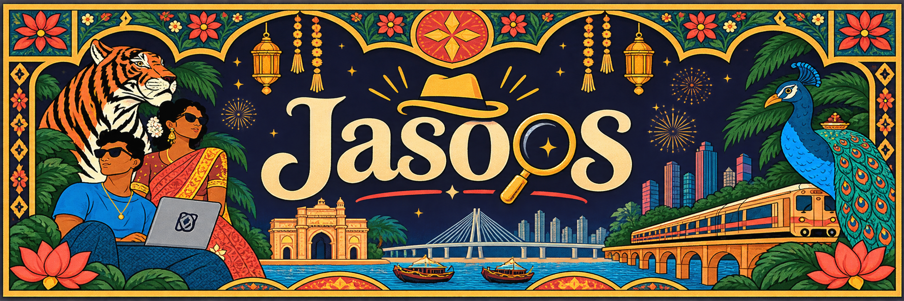

<p align="center">
  
</p>

<p align="center">
  <b>Built at ETHGlobal Mumbai · November 5–7, 2026 · Mumbai, India</b><br>
  0G Private Computer · Arkiv · World ID
</p>

# ETH Jasoos: describe a scene, then walk into it and solve it

*Jasoos* is Hindi for "detective". Type one sentence, for example *"a
rain-flooded night market in Mumbai, I'm a courier carrying a tiffin box
someone will kill for"*. Seconds later you are **walking through that world
with the arrow keys**: a top-down retro-RPG street painted live on 0G Private
Computer, a player sprite in the same art style, buildings you can enter,
characters who talk back out loud, and one mystery with a culprit you have to
name.

Every world is saved on Arkiv, so anyone can replay it from the gallery. Every
player is one verified human, through World ID.

## Why generation is load-bearing

The game cannot exist without fast, cheap, high-volume generation:

- **Nothing is pre-made.** The street, the player sprite, every interior and
  the finale frame are all generated while you play.
- **Spatial prefetch.** When a screen shows a door, its interior and that
  room's opening conversation start generating in the background, so going
  inside is usually instant.
- **Every call is counted.** The HUD shows "*N* generations" for the run. One
  run makes about 20 or more model calls: the world plan, screen images, vision
  passes, dialogue turns and the finale.

## How a run plays out

**Dialogue:** each character guards one clue to the world's single mystery.
Conversations are short: the clue comes out by the second exchange, and the
chat closes by the third. Character lines are voiced with Sarvam Bulbul v3.

**Accusation:** one of the three characters is the culprit, and they lie about
their own part. Once you hold all 3 clues, **Accuse** lets you name one of
them. Name the right one and the victory finale reveals the secret, out loud.
Name the wrong one and the culprit walks free (defeat). Running out of time or
maxing out the danger meter is also a defeat.

**The answer never reaches the browser.** The world plan's secret and culprit
are encrypted (AES-256-GCM) with a key derived from `SESSION_SECRET`, both in
the browser and on Arkiv. Only the server can open them. `/api/finale` judges
each accusation against the saved plan, and keeps the victory finale sealed
until someone accuses correctly.

## Sponsors, by weight

Sponsors are ordered by how much of the game stops working without them.

| Weight | Sponsor | What happens without it |
| --- | --- | --- |
| **1 · Core** | **0G Private Computer** | No world exists. The world plan, every screen image and its vision pass, the interiors, the sprite, every line of dialogue and the finale are all 0G calls, so there is nothing to walk through, talk to or solve |
| **2 · State** | **Arkiv** | Worlds disappear on restart. There is no shared gallery and no replays, and nobody else can play or list a world without our server |
| **3 · Gate** | **World ID** | One person with throwaway accounts could create unlimited worlds, use up the shared 0G credits and flood the gallery |

### 1 · 0G Private Computer (core)

- One OpenAI-compatible client, pointed at `https://router-api.0g.ai/v1`,
  makes every text, vision and image call.
- Models: `0gm-1.0-35b-a3b` (world plan, story, dialogue), `qwen3-vl-plus`
  (reads each frame into walkable areas, doors and characters),
  `bytedance/seedream-5.0-flash` (streets, interiors, sprite, finale). Each one
  can be overridden with `ZG_CHAT_MODEL`, `ZG_VISION_MODEL` and
  `ZG_IMAGE_MODEL`.
- Every chat and vision reply carries 0G's request ID, read from
  `x_0g_trace.request_id` in the client.
- **What breaks without 0G:** every frame and every line of the game comes from
  a 0G call, so without it there is nothing to walk through or talk to.
- 0G image models only take text, so the previous frame is not passed as a
  reference. The style guide in every prompt keeps the look consistent, but
  neighbouring screens may not line up exactly at their edges.

### 2 · Arkiv (state)

- Network: the rabdi testnet (chain id `7794095`), through `@arkiv-network/sdk`.
- Entities, each tagged `project` + `entityType`:
  - `game`: one per world. Indexed `owner` (hash of the World ID nullifier)
    and `createdAt`; the record is gzipped JSON. Expires after 90 days.
  - `scene`: saved interiors (and legacy street tiles), indexed by `gameId`, `sceneId`, `createdAt`.
  - `screen`: street tiles, also indexed by `worldKey`, `x`, `y`; gzipped metadata and asset URLs.
  - `unlock`: evidence opens, indexed by `worldKey`, `humanHash`.
  - `accusation`: one guess per human/game. `correct` is public; the guessed suspect is sealed
    (`sealedAccused`), so the chain shows a case's solve rate without revealing the answer.
  All new entities use a 90-day lifetime.
- **Reads that players see:** the home gallery (`GET /api/games`), replaying a
  world (`/play/[gameId]`), and the per-player creation limit
  (`GET /api/profile`).
- **Kept off Arkiv:** image bytes (files under `ASSET_DIR`), World ID proofs,
  and model calls. The mystery's answer and the victory finale are stored only
  encrypted, because Arkiv entities are public.
- **Signer wallet** recorded in [`arkiv/how-you-use-arkiv.md`](arkiv/how-you-use-arkiv.md):
  [`0xf9976C655C3f61f5C7b0E8a0655d6c2195F483b5`](https://rabdi.explorer.arkiv.network/address/0xf9976C655C3f61f5C7b0E8a0655d6c2195F483b5).
- **A query anyone can run** (newest worlds, the same query as the gallery):

  ```ts
  import { createPublicClient } from "@arkiv-network/sdk";
  import { rabdi } from "@arkiv-network/sdk/chains";
  import { and, desc, eq } from "@arkiv-network/sdk/query";
  import { bytes, defineSchema, str, u64 } from "@arkiv-network/sdk/schema";
  import { http } from "viem";

  const Game = defineSchema({
    project: str().indexed(), entityType: str().indexed(),
    owner: str().indexed(), createdAt: u64().indexed(), record: bytes(),
  });
  const client = createPublicClient({ chain: rabdi({ accessKey: "" }), transport: http() });
  const page = await client
    .select({ $key: true, owner: true, createdAt: true })
    .from(Game)
    .where(and(eq("project", "ethjasoos"), eq("entityType", "game")))
    .orderBy(desc("createdAt"))
    .limit(24)
    .fetch();
  console.log(page.entities);
  ```

- Judge files: [`arkiv/schema.md`](arkiv/schema.md),
  [`arkiv/friction.md`](arkiv/friction.md), [`arkiv/reach.md`](arkiv/reach.md),
  [`arkiv/why-arkiv.md`](arkiv/why-arkiv.md),
  [`arkiv/how-you-use-arkiv.md`](arkiv/how-you-use-arkiv.md).

### 3 · World ID (gate)

Integration notes: [World ID debrief](docs/world-id-debrief.md).

- **The trust moment:** creating a world spends shared 0G compute.
  `FREE_GAME_LIMIT` caps how many worlds each person may create, so the app
  needs to know that it is dealing with one unique human, and nothing else.
- **Credential:** Proof of Human. It is the smallest credential that answers
  "is this one unique person?". The game needs nothing about age or nationality.
- **Server check:** the IDKit result is checked locally (action, environment,
  one nullifier), then forwarded to the World Developer Portal
  (`/api/v4/verify`). Only a namespaced SHA-256 of the nullifier is kept, as the
  player id, in an HMAC-signed cookie.
- **The other path:** without a valid session, every page redirects to
  `/login`, and every generation API returns `401`.

## Run it

```bash
npm install
cp .env.example .env.local   # then set ZG_COMPUTE_API_KEY (see below)
npm run dev                  # http://localhost:3000
```

Next reads `.env.local` only at startup, so restart `npm run dev` after
changing it.

Controls: **WASD / arrows** move · **E** enter or talk · **1–3** pick a reply ·
type anything to any character · **Esc** leave.

### Environment variables

| Variable | Needed for | Without it |
| --- | --- | --- |
| `ZG_COMPUTE_API_KEY` | **every** text, vision and image call (0G router key `sk-...`, from [pc.0g.ai](https://pc.0g.ai)) | creating or playing a new world fails |
| `FREE_GAME_LIMIT` | worlds each player may create (`.env.example` sets `3`) | `0`: creation is off, gallery only |
| `ZG_COMPUTE_BASE_URL` | 0G router | `https://router-api.0g.ai/v1` |
| `ZG_CHAT_THINKING` | `on` restores reasoning on 0gm text calls | `off` (lower latency) |
| `ZG_CHAT_MODEL` · `ZG_VISION_MODEL` · `ZG_IMAGE_MODEL` | model ids | `0gm-1.0-35b-a3b` · `qwen3-vl-plus` · `bytedance/seedream-5.0-flash` |
| `WORLD_APP_ID` · `WORLD_RP_ID` · `WORLD_RP_SIGNING_KEY` | real World ID sign-in | dev builds sign in one local test player |
| `WORLD_ACTION_ID` · `WORLD_ENVIRONMENT` | World ID action and proof environment | `sign-in` · `staging` (simulator proofs) |
| `SESSION_SECRET` | signing the session cookie and sealing each world's answer (keep it stable) | fixed dev secret; **required in production** |
| `ARKIV_SIGNER_KEY` · `ARKIV_RPC_URL` · `ARKIV_ACCESS_KEY` · `ARKIV_PROJECT_ID` | saving worlds on Arkiv | in-memory store, lost on restart |
| `UNLIMITED_PLAYERS` | comma-separated player ids that skip `FREE_GAME_LIMIT` | none |
| `ASSET_DIR` | where generated images are saved | `.data/assets` |
| `SARVAM_API_KEY` (+ `SARVAM_TTS_MODEL`, `SARVAM_TTS_LANGUAGE`) | character voices | characters are silent |
| `NEXT_PUBLIC_SESSION_TIME_LIMIT_SEC` | play-session timer, in seconds | `300` |
| `NEXT_PUBLIC_POSTHOG_PROJECT_TOKEN` · `NEXT_PUBLIC_POSTHOG_HOST` | analytics | no events sent |

Keep real keys in `.env.local` only; `.env.example` holds placeholders.

**World ID setup:** in the [World Developer Portal](https://developer.world.org),
create an app and an action (default `sign-in`), then set `WORLD_APP_ID`,
`WORLD_RP_ID` and `WORLD_RP_SIGNING_KEY`. `WORLD_ENVIRONMENT=staging` accepts
proofs from the [simulator](https://simulator.worldcoin.org); `sandbox` accepts the World ID
Sandbox test app (turn off its attestation enforcement under **World ID Sandbox** in the portal,
or World answers 403 `integrity_verification_failed`); `production` accepts the real World App.

**Arkiv setup:** set `ARKIV_SIGNER_KEY` to a funded burner key
([faucet](https://hub.arkiv.network/faucet)), and set `ARKIV_ACCESS_KEY` for the
RPC endpoint without rate limits.

### Deploy (Railway or Render)

The app is one long-running Node server. Generated images are written to
`ASSET_DIR` on disk, so the host needs a **persistent volume**: a serverless
host would lose them.

1. Create a Node service from this repo. Build: `npm ci && npm run build`.
   Start: `npm start` (Next reads the host's `PORT`).
2. Attach a persistent volume (e.g. mounted at `/data`) and set
   `ASSET_DIR=/data/assets`.
3. Set the environment. Required: `ZG_COMPUTE_API_KEY`, a long random
   `SESSION_SECRET` that **never changes** (it seals every world's answer),
   `FREE_GAME_LIMIT` (e.g. `3`), the World ID keys with
   `WORLD_ENVIRONMENT=production` for real World App users, and
   `ARKIV_SIGNER_KEY` (funded) plus `ARKIV_ACCESS_KEY`. Without the Arkiv key,
   saved worlds live in memory and vanish on restart. Optional: `SARVAM_API_KEY`
   and PostHog.
4. Run one instance only: the in-memory fallback and the Arkiv write queue
   are per process.

## Other services (not sponsors)

| Service | Job |
| --- | --- |
| Sarvam Bulbul v3 | speaks every character line and the finale |
| PostHog | product analytics, proxied through `/ingest` |

## Impact in India

Jasoos turns any Indian setting (a Chandni Chowk gali, the Kerala backwaters,
a Himalayan pilgrimage) into a playable, voiced world in seconds, with no art
budget. That makes room for regional stories and folklore in any of India's
languages (swap the voice), for classrooms that describe a historical scene and
walk through it, and for indie game developers, because world art drops from
lakhs of rupees to paise.

## Project map

| Path | Role |
| --- | --- |
| `lib/world-engine.ts` | world plan, screens, interiors, sprite, dialogue, voice and finale generation |
| `lib/zg-client.ts` | the 0G Private Computer client: chat and vision with retries, image generation |
| `lib/arkiv.ts` | `game` and `scene` entities on Arkiv (in memory without a signer key) |
| `lib/worldid.ts` | World ID proof check, signed session cookie, `requireUser()` |
| `lib/games.ts` | saved-image files, row mapping, creation limit |
| `lib/sarvam.ts` | Sarvam Bulbul v3 voices |
| `lib/music.ts` · `lib/sfx.ts` | generative background music, UI sound effects |
| `proxy.ts` | sends visitors without a valid session to `/login` |
| `app/login` · `app/api/session` | World ID sign-in and sign-out |
| `app/api/games/*` · `app/api/profile` | saved-worlds REST API and creation limit |
| `app/play/[gameId]` | plays a saved world (new worlds start on Home) |
| `components/Home.tsx` | gallery and the create box |
| `components/World.tsx` | runs a world: scene cache, prefetch, clues, finale, saving |
| `components/GameCanvas.tsx` | canvas loop: movement, collision, hotspots, sprite |
| `components/DialogueBox.tsx` | voiced conversations |
| `lib/engine/codec.ts` · `components/Decoder.tsx` | the hidden-note codec and Decoder, not wired into the game yet |
| `app/api/finale` | judges accusations; seals and saves the victory finale |

## Docs

| File | What it covers |
| --- | --- |
| [`docs/PRD.md`](docs/PRD.md) | product requirements and design for the detective world (target spec) |
| [`docs/specs/2026-11-06-detective-clues-design.md`](docs/specs/2026-11-06-detective-clues-design.md) | detective clues, overworld, lane split |
| [`docs/GAME_DESIGN.md`](docs/GAME_DESIGN.md) | the play loop and which model does what |
| [`docs/DESIGN_BRIEF.md`](docs/DESIGN_BRIEF.md) | screens, play-screen layout, visual language |
| [`docs/CHOICE_MODE_PRD.md`](docs/CHOICE_MODE_PRD.md) | the earlier turn-based choice mode (code kept, not routed) |
| [`docs/TEAM_STATUS.md`](docs/TEAM_STATUS.md) | lane status |
| [`AGENTS.md`](AGENTS.md) | conventions for AI agents and the team message board |

## Checks

```bash
npm run lint        # 0 errors
npm run typecheck
npm test
npm run build
```

## Known issues

- **Players can't spend their own 0G credits.** The iAI sign-in bonus was cut;
  every call uses the server's `ZG_COMPUTE_API_KEY`.
- **No `game` entities on rabdi yet.** The query above returns `[]` until a
  world is saved with `ARKIV_SIGNER_KEY` set.
- **The World ID evidence proof hasn't run against the real simulator yet.**
  Per-case actions (`evidence-<gameId>`) are implemented and tested with mocks;
  [`docs/world-id-debrief.md`](docs/world-id-debrief.md) lists what is still
  unconfirmed (#19).
- **Dialogue trusts the client for everything except the answer.**
  `/api/dialogue` takes the world plan, `clueFound`, `exchanges`, `heat` and
  `inventory` from the request body. The clue and close rules run on the
  server (`applyDialogueRules`), but on the numbers the client sends. A player
  can edit those, and can get a clue early that way. They cannot read or
  change the sealed secret, culprit or key.
- **Changing `SESSION_SECRET` locks saved worlds.** Their sealed answers can
  no longer be opened, so they can't be played to the end.

## Team

| Lane | Who | Owns |
| --- | --- | --- |
| A | Amogh Sunil ([@stealthwhizz](https://github.com/stealthwhizz))| engine and 0G generation |
| B | Suraj ([@surajgojanur](https://github.com/surajgojanur)) | game client |
| C | Kishore ([@kishikishore2863](https://github.com/kishikishore2863)) | World ID, Arkiv |

## How we used AI

- **In the product:** every world, image and line of dialogue is generated by
  models on 0G Private Computer, as described above.
- **In development:** the team wrote code with AI coding agents. The rules they
  follow are in [`AGENTS.md`](AGENTS.md), and they coordinate on the pinned
  Message Board issue (#3).

## License

[MIT](LICENSE)
